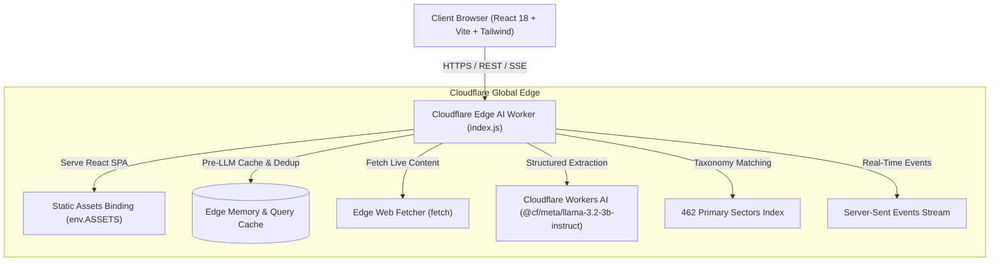

# Project Intelligence Platform

> **100% Serverless Edge AI-Powered Global Capital Project Intelligence Platform**
> Built with **React 18 + TypeScript + Cloudflare Workers AI (Meta Llama 3.2 3B Instruct) + Edge Web Fetcher + 462 Primary Sector Taxonomy**

---

## 🌟 Overview

The **Project Intelligence Platform** is a serverless, edge-native discovery engine for global capital projects. The entire application runs at Cloudflare's global edge without legacy containers, slow cold starts, or 502 errors.

### Core Capabilities

1. **Cloudflare Workers AI (`@cf/meta/llama-3.2-3b-instruct`)**:
   - Executes structured entity extraction directly on Cloudflare edge GPUs.
   - Extracts canonical project name, developer, sector, investment valuation, capacity, location, status, and evidentiary quote from raw webpage HTML.

2. **Pre-LLM Deduplication & Cache Guardrails**:
   - **Zero Duplicate Queries**: Checks edge memory store before initiating external calls or LLM queries.
   - **Zero Duplicate URLs**: Normalizes URLs (stripping UTM tracking parameters, session fragments, trailing slashes) and deduplicates across past and active discovery runs.
   - **Strict Domain Reputation Filter**: Automatically rejects encyclopedias, dictionaries, social media, auth portals, and non-HTML assets (PDFs, media files).

3. **Edge Web Fetcher**:
   - Fetches live web pages with timeout guards and User-Agent headers.
   - Strips scripts, styles, navigation bars, footers, and HTML noise, passing high-density prose to the LLM.

4. **462 Primary Industrial Sectors Taxonomy**:
   - Indexes all 462 official capital project sectors with definitions, synonyms, and subcategories directly at the edge (`primary_sectors.json`).
   - Normalizes queries and extracts taxonomy tags automatically.

5. **Unified Edge Architecture**:
   - Handled completely by `cloudflare/gateway/index.js` (no Python containers, no Render spin-downs).
   - Serves the production React 18 SPA statically via Cloudflare Workers Assets.
   - Exposes REST endpoints (`/api/v1/search`, `/api/v1/projects`, `/api/v1/sectors`, `/api/v1/analytics`, `/api/v1/monitoring`) and real-time SSE telemetry (`/api/v1/search/:id/events`).

---

## 🏗️ Architecture



---

## 📁 Repository Structure

```
project-intelligence-platform/
├── cloudflare/
│   └── gateway/
│       ├── index.js               # Unified Edge AI Worker & API (all endpoints, LLM extraction, fetcher)
│       ├── package.json           # Cloudflare Worker scripts (dev, deploy)
│       ├── primary_sectors.json   # 462 canonical industrial sectors and definitions
│       └── wrangler.jsonc         # Wrangler config with Workers AI and static assets binding
├── frontend/
│   ├── dist/                      # Production build assets served by the Worker
│   ├── src/
│   │   ├── components/            # SectorBadge, SectorSelector, layout components
│   │   ├── data/                  # primary_sectors.json taxonomy
│   │   ├── pages/                 # Search, Results, Projects, Detail, Analytics, Monitoring, Settings
│   │   ├── services/              # API client & SSE streaming service
│   │   └── types/                 # TypeScript interfaces
│   ├── package.json               # Frontend dependencies & scripts
│   └── vite.config.ts             # Vite bundler configuration
├── .gitignore                     # Git ignore rules
└── README.md                      # Platform documentation
```

---

## 🚀 Development & Deployment

### 1. Frontend Development

```bash
cd frontend
npm install
npm run build
```

### 2. Cloudflare Edge Worker Deployment

```bash
cd cloudflare/gateway
npx wrangler deploy
```

The unified worker will automatically bundle the React SPA from `frontend/dist` and deploy the edge application to your Cloudflare domain.

---

## 🛡️ Security & Privacy Guardrails

- **Zero Client-Side Secrets**: All API requests and Workers AI calls execute server-side in the Worker.
- **Strict URL Sanitation**: Blocks private IP addresses, localhost, RFC 1918 ranges, and malformed URLs.
- **No Hallucination Mandate**: The LLM extraction prompt strictly instructs Llama 3.2 to only extract explicitly stated metrics and leave unconfirmed values null.
