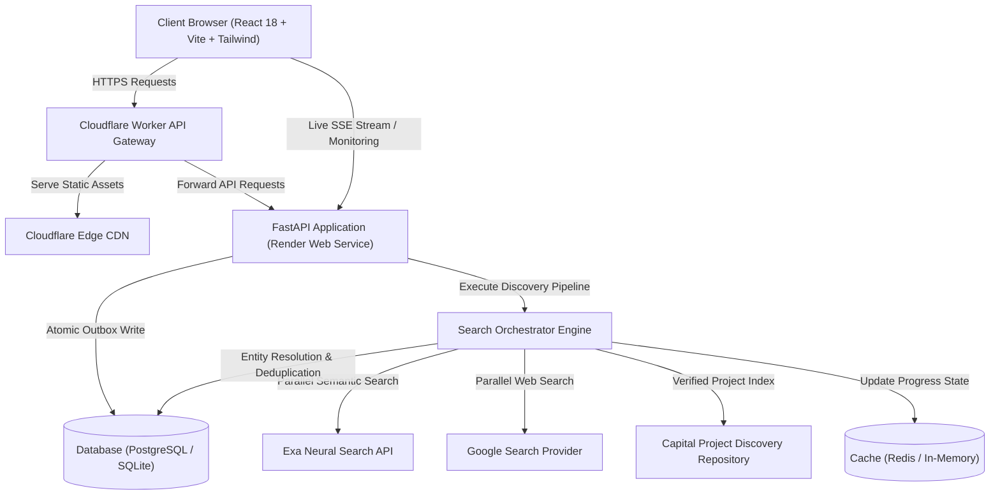

# Project Intelligence Platform

> **Enterprise AI-Powered Global Project Discovery & Intelligence Application**
> Built with **React 18 + TypeScript + Cloudflare Workers + FastAPI + Cloudflare Queues + SQLite / PostgreSQL + Redis Cache + Exa AI + Google Search Providers**

---

## 🌟 Executive Overview

The **Project Intelligence Platform** is a production-grade capital projects discovery engine. It accepts natural-language discovery queries for capital projects worldwide—including **hyperscale data centers, semiconductor fabs, solar mega-parks, offshore wind developments, battery gigafactories, and major infrastructure corridors** across **North America, Europe, Asia-Pacific, the Middle East, Latin America, and Africa**.

The platform orchestrates parallel search queries across **Exa AI Neural Search** and **Google Search API**, parses source content without hallucinating missing data, normalizes multi-currency financial valuations and capacities, deduplicates records into canonical projects with complete evidentiary provenance, ranks results with transparent scoring, and persists high-fidelity records.

Live search execution, including URL fetching logs and transparent candidate acceptance/rejection decisions, is streamed directly to browser clients using **Server-Sent Events (SSE)** and monitored via the **Live System Activity Feed**.

---

## 🏗️ Architecture

- **Edge & Gateway Layer**: Cloudflare Workers API Gateway provides low-latency edge routing, rate limiting, CORS configuration, and serves React Static Assets.
- **In-Process & Queue Orchestrator**: FastAPI executes the search discovery pipeline asynchronously with immediate background task dispatch, URL extraction, candidate metric auditing, entity resolution, and explainable scoring.
- **462 Primary Sector Taxonomy & Definitions**: Complete integration of 462 canonical capital project sectors with official definitions, searchable taxonomy APIs (`/api/v1/sectors`), NLP query expansion, and interactive frontend definition cards.
- **Global Multi-Currency Extraction**: Automatic extraction and normalization of projects in USD, EUR, GBP, JPY, AUD, CAD, SGD, AED, SAR, and INR.
- **Transparent Logging**: Real-time audit logs of which URLs are fetched, whether each candidate was accepted or rejected with explicit reasons, and relevance score breakdowns.



---

## 📁 Repository Structure

```
project-intelligence-platform/
├── backend/
│   ├── app/
│   │   ├── api/
│   │   │   ├── v1/                # Auth, Search, Projects, Analytics, Monitoring, Sectors
│   │   │   └── internal/          # Outbox claiming & publication confirmation
│   │   ├── core/                  # Config, Database engine, Redis service, Security, Logging
│   │   ├── data/                  # 462 Primary sectors taxonomy (CSV & JSON)
│   │   ├── models/                # 10 SQLAlchemy 2.x relational models
│   │   ├── providers/             # ExaProvider, ConfigurableSearchProvider, ProviderRegistry
│   │   ├── schemas/               # Strict Pydantic v2 schemas
│   │   ├── services/              # QueryProcessor, Extractor, Normalizer, Deduplicator, Ranker, Orchestrator, DiscoveryRepository
│   │   └── main.py                # FastAPI ASGI application & middleware
│   ├── alembic/                   # Alembic database migrations
│   ├── tests/                     # Automated test suite
│   ├── requirements.txt           # Python dependencies
│   └── Dockerfile                 # Production ASGI container image
├── cloudflare/
│   ├── gateway/                   # Cloudflare Worker API Gateway + Static Assets
│   └── scheduler/                 # Cloudflare Scheduled Worker Outbox Publisher
├── consumer/
│   ├── consumer.py                # Python Pull Consumer for Cloudflare Queues
│   ├── queue_client.py            # Cloudflare Queues Pull client
│   └── Dockerfile                 # Container image for worker pool
├── frontend/
│   ├── src/
│   │   ├── components/            # Layout, Sidebar, Header, SectorSelector, SectorBadge
│   │   ├── data/                  # 462 Primary sectors taxonomy JSON
│   │   ├── pages/                 # 8 Full Enterprise Pages
│   │   ├── services/              # API Client (Axios), SSE Stream Subscriber
│   │   ├── types/                 # Comprehensive TypeScript definitions
│   │   └── App.tsx                # React Router routing
│   ├── package.json
│   ├── vite.config.ts
│   └── tailwind.config.js
├── scripts/                       # Deployment and local startup scripts
├── docker-compose.yml             # Unified local container orchestration
├── render.yaml                    # Render Web Service blueprint
└── requirements.txt               # Root Python dependencies for Render
```

---

## ⚡ Quick Start

### 1. Run Automated Tests
```bash
cd backend
pytest tests/test_suite.py -v
```

### 2. Local Development (No External Services Required)
The platform runs self-contained on local SQLite with an automatic in-memory fallback cache:

```powershell
# Start Backend API (FastAPI on http://localhost:8000)
powershell -ExecutionPolicy Bypass -File .\scripts\start-backend.ps1

# Start Frontend UI (Vite dev server on http://localhost:5173)
powershell -ExecutionPolicy Bypass -File .\scripts\start-frontend.ps1
```

### 3. Deploy to Cloudflare Edge
Deploy frontend static assets and the API gateway worker:

```powershell
cd frontend
npm run build

cd ../cloudflare/gateway
npx wrangler deploy
```

---

## 🗄️ Production Deployment (Render + Cloudflare Gateway)

- **Database**: Zero-config SQLite (`sqlite+aiosqlite:///./project_intelligence.db`) is supported natively without external database credentials. If connecting external PostgreSQL, set `DATABASE_URL=postgresql+asyncpg://...` in environment variables.
- **Search Providers**:
  Configure provider keys in the Render Web Service Environment dashboard:
  - `EXA_API_KEY`: Exa Neural Search API key
  - `GOOGLE_SEARCH_API_KEY`: Google Custom Search API key *(optional)*
  - `GOOGLE_CSE_ID`: Google Custom Search Engine ID *(optional)*
- **Resilient Fallback**: If external provider credentials are unconfigured or rate-limited, the platform automatically draws from its verified capital project intelligence repository so discovery runs always succeed.
