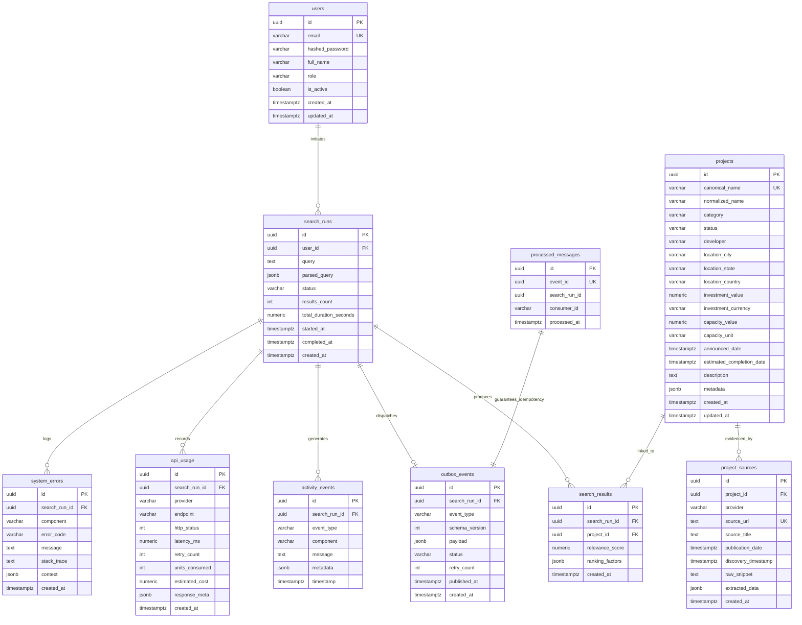

# Database Design & Relational Schema: Project Intelligence Platform

## Schema Overview

The database is built on PostgreSQL 16+ using strict relational normalization, UUIDs for distributed entities, `NUMERIC` for financial precision, `TIMESTAMPTZ` for microsecond-precision audit trails, and foreign key cascades.

---

## Detailed Table Specifications

### 1. `users`
- `id`: UUID (Primary Key, default `gen_random_uuid()`)
- `email`: VARCHAR(255) UNIQUE NOT NULL, indexed
- `hashed_password`: VARCHAR(255) NOT NULL
- `full_name`: VARCHAR(255) NOT NULL
- `role`: VARCHAR(50) NOT NULL DEFAULT 'user' (values: 'admin', 'user')
- `is_active`: BOOLEAN NOT NULL DEFAULT TRUE
- `created_at`: TIMESTAMPTZ NOT NULL DEFAULT NOW()
- `updated_at`: TIMESTAMPTZ NOT NULL DEFAULT NOW()

### 2. `search_runs`
- `id`: UUID (Primary Key)
- `user_id`: UUID NULLABLE (FK -> `users.id` ON DELETE SET NULL)
- `query`: TEXT NOT NULL
- `parsed_query`: JSONB NOT NULL DEFAULT '{}'
- `status`: VARCHAR(50) NOT NULL DEFAULT 'queued' (queued, processing, completed, partially_completed, failed, cancelled)
- `results_count`: INTEGER NOT NULL DEFAULT 0
- `total_duration_seconds`: NUMERIC(10, 3) NULL
- `started_at`: TIMESTAMPTZ NULL
- `completed_at`: TIMESTAMPTZ NULL
- `created_at`: TIMESTAMPTZ NOT NULL DEFAULT NOW()
- *Indexes*: `(status)`, `(created_at DESC)`, `(user_id)`

### 3. `projects`
- `id`: UUID (Primary Key)
- `canonical_name`: VARCHAR(300) NOT NULL UNIQUE
- `normalized_name`: VARCHAR(300) NOT NULL
- `category`: VARCHAR(100) NOT NULL (e.g., 'Data Center', 'Solar Power', 'Semiconductor', 'Renewable Energy')
- `status`: VARCHAR(50) NOT NULL (e.g., 'Announced', 'Under Development', 'Under Construction', 'Operational', 'Cancelled')
- `developer`: VARCHAR(255) NULL
- `location_city`: VARCHAR(100) NULL
- `location_state`: VARCHAR(100) NULL
- `location_country`: VARCHAR(100) NOT NULL DEFAULT 'India'
- `investment_value`: NUMERIC(18, 2) NULL
- `investment_currency`: VARCHAR(10) NULL DEFAULT 'INR'
- `capacity_value`: NUMERIC(18, 2) NULL
- `capacity_unit`: VARCHAR(50) NULL (e.g., 'MW', 'GW', 'Sq Ft', 'Units/month')
- `announced_date`: TIMESTAMPTZ NULL
- `estimated_completion_date`: TIMESTAMPTZ NULL
- `description`: TEXT NULL
- `metadata`: JSONB NOT NULL DEFAULT '{}'
- `created_at`: TIMESTAMPTZ NOT NULL DEFAULT NOW()
- `updated_at`: TIMESTAMPTZ NOT NULL DEFAULT NOW()
- *Indexes*: `(category)`, `(location_state)`, `(location_city)`, `(status)`, `(normalized_name)`

### 4. `project_sources`
- `id`: UUID (Primary Key)
- `project_id`: UUID NOT NULL (FK -> `projects.id` ON DELETE CASCADE)
- `provider`: VARCHAR(50) NOT NULL ('exa', 'brave', etc.)
- `source_url`: TEXT NOT NULL UNIQUE
- `source_title`: TEXT NULL
- `publication_date`: TIMESTAMPTZ NULL
- `discovery_timestamp`: TIMESTAMPTZ NOT NULL DEFAULT NOW()
- `raw_snippet`: TEXT NULL
- `extracted_data`: JSONB NOT NULL DEFAULT '{}'
- `created_at`: TIMESTAMPTZ NOT NULL DEFAULT NOW()
- *Indexes*: `(project_id)`, `(provider)`

### 5. `search_results`
- `id`: UUID (Primary Key)
- `search_run_id`: UUID NOT NULL (FK -> `search_runs.id` ON DELETE CASCADE)
- `project_id`: UUID NOT NULL (FK -> `projects.id` ON DELETE CASCADE)
- `relevance_score`: NUMERIC(5, 4) NOT NULL DEFAULT 0.0000
- `ranking_factors`: JSONB NOT NULL DEFAULT '{}'
- `created_at`: TIMESTAMPTZ NOT NULL DEFAULT NOW()
- *Constraints*: UNIQUE(`search_run_id`, `project_id`)
- *Indexes*: `(search_run_id, relevance_score DESC)`

### 6. `api_usage`
- `id`: UUID (Primary Key)
- `search_run_id`: UUID NOT NULL (FK -> `search_runs.id` ON DELETE CASCADE)
- `provider`: VARCHAR(50) NOT NULL
- `endpoint`: VARCHAR(255) NOT NULL
- `http_status`: INTEGER NOT NULL
- `latency_ms`: NUMERIC(10, 2) NOT NULL
- `retry_count`: INTEGER NOT NULL DEFAULT 0
- `units_consumed`: INTEGER NOT NULL DEFAULT 1
- `estimated_cost`: NUMERIC(10, 6) NULL
- `response_meta`: JSONB NOT NULL DEFAULT '{}'
- `created_at`: TIMESTAMPTZ NOT NULL DEFAULT NOW()
- *Indexes*: `(provider)`, `(created_at DESC)`

### 7. `activity_events`
- `id`: UUID (Primary Key)
- `search_run_id`: UUID NOT NULL (FK -> `search_runs.id` ON DELETE CASCADE)
- `event_type`: VARCHAR(50) NOT NULL
- `component`: VARCHAR(50) NOT NULL
- `message`: TEXT NOT NULL
- `metadata`: JSONB NOT NULL DEFAULT '{}'
- `timestamp`: TIMESTAMPTZ NOT NULL DEFAULT NOW()
- *Indexes*: `(search_run_id, timestamp ASC)`

### 8. `outbox_events`
- `id`: UUID (Primary Key)
- `search_run_id`: UUID NOT NULL (FK -> `search_runs.id` ON DELETE CASCADE)
- `event_type`: VARCHAR(100) NOT NULL DEFAULT 'project_search_requested'
- `schema_version`: INTEGER NOT NULL DEFAULT 1
- `payload`: JSONB NOT NULL
- `status`: VARCHAR(50) NOT NULL DEFAULT 'pending' (pending, claimed, published, failed)
- `retry_count`: INTEGER NOT NULL DEFAULT 0
- `published_at`: TIMESTAMPTZ NULL
- `created_at`: TIMESTAMPTZ NOT NULL DEFAULT NOW()
- *Indexes*: `(status, created_at ASC)`

### 9. `processed_messages`
- `id`: UUID (Primary Key)
- `event_id`: UUID NOT NULL UNIQUE
- `search_run_id`: UUID NOT NULL
- `consumer_id`: VARCHAR(100) NOT NULL
- `processed_at`: TIMESTAMPTZ NOT NULL DEFAULT NOW()
- *Indexes*: `(event_id)`

### 10. `system_errors`
- `id`: UUID (Primary Key)
- `search_run_id`: UUID NULLABLE (FK -> `search_runs.id` ON DELETE SET NULL)
- `component`: VARCHAR(100) NOT NULL
- `error_code`: VARCHAR(50) NOT NULL
- `message`: TEXT NOT NULL
- `stack_trace`: TEXT NULL
- `context`: JSONB NOT NULL DEFAULT '{}'
- `created_at`: TIMESTAMPTZ NOT NULL DEFAULT NOW()
- *Indexes*: `(component)`, `(created_at DESC)`
