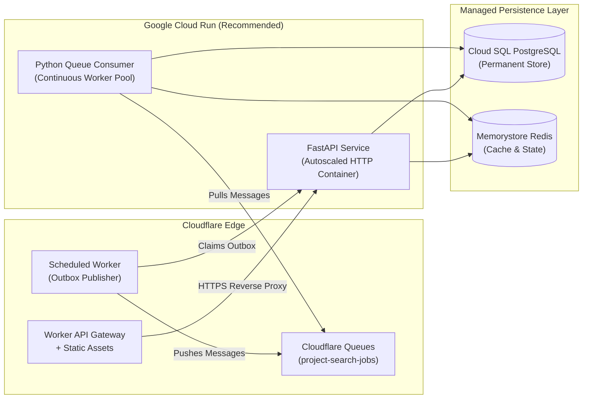

# Deployment Guide: Project Intelligence Platform

## Overview

The Project Intelligence Platform architecture decouples the edge gateway and static frontend from the backend compute containers and asynchronous queue workers.



---

## 1. Cloudflare Infrastructure Deployment

### Prerequisites
- Node.js 18+ and `npm` installed.
- Cloudflare account with Queues enabled.
- Logged into Cloudflare via `npx wrangler login`.

### Step 1: Create Cloudflare Queues
```bash
# Create main search queue
npx wrangler queues create project-search-jobs

# Create dead-letter queue
npx wrangler queues create project-search-jobs-dlq
```

### Step 2: Build & Deploy Frontend Static Assets + API Gateway
```bash
# 1. Build React frontend bundle
cd frontend
npm install
npm run build
cd ..

# 2. Deploy Cloudflare Worker API Gateway
cd cloudflare/gateway
npm install
npx wrangler deploy
```

### Step 3: Deploy Scheduled Outbox Publisher Worker
```bash
cd cloudflare/scheduler
npm install
npx wrangler secret put INTERNAL_API_KEY
# Enter your strong internal service key
npx wrangler deploy
```

---

## 2. Backend Container Deployment (Google Cloud Run Candidate)

The FastAPI web API and Python Pull Consumer are packaged into independent container images and deployed separately.

### Step 1: Managed PostgreSQL & Redis
1. **PostgreSQL 16**: Provision Google Cloud SQL for PostgreSQL (or AWS RDS / Supabase).
2. **Redis 7**: Provision Google Cloud Memorystore for Redis (or AWS ElastiCache / Upstash).
3. Set `DATABASE_URL` (format: `postgresql+asyncpg://<user>:<password>@<host>:5432/<dbname>`).
4. Set `REDIS_URL` (format: `redis://<host>:6379/0`).

### Step 2: Run Alembic Database Migrations
Run migrations from your CI/CD runner or container startup:
```bash
cd backend
alembic upgrade head
```

### Step 3: Deploy FastAPI Container (Cloud Run Service)
```bash
gcloud run deploy project-intelligence-api \
  --source=./backend \
  --region=us-central1 \
  --allow-unauthenticated \
  --set-env-vars="APP_ENV=production,DATABASE_URL=...,REDIS_URL=...,SECRET_KEY=...,INTERNAL_API_KEY=...,EXA_API_KEY=...,SECOND_PROVIDER_API_KEY=..." \
  --min-instances=1 \
  --max-instances=10 \
  --memory=1Gi \
  --cpu=1
```

### Step 4: Deploy Python Pull Consumer (Cloud Run Worker / Continuous Container)
The consumer requires persistent polling loop execution:
```bash
gcloud run deploy project-intelligence-consumer \
  --source=. \
  --dockerfile=consumer/Dockerfile \
  --region=us-central1 \
  --no-allow-unauthenticated \
  --set-env-vars="APP_ENV=production,DATABASE_URL=...,REDIS_URL=...,INTERNAL_API_KEY=...,EXA_API_KEY=...,SECOND_PROVIDER_API_KEY=...,CLOUDFLARE_ACCOUNT_ID=...,CLOUDFLARE_API_TOKEN=..." \
  --min-instances=1 \
  --max-instances=5 \
  --memory=1Gi \
  --cpu=1
```

---

## 3. Local Development with Docker Compose

For a complete local stack containing PostgreSQL, Redis, FastAPI, and Consumer in one command:
```bash
docker compose up --build
```
- API available at `http://localhost:8000`
- Interactive API Docs at `http://localhost:8000/docs`
- PostgreSQL on port `5432`
- Redis on port `6379`
