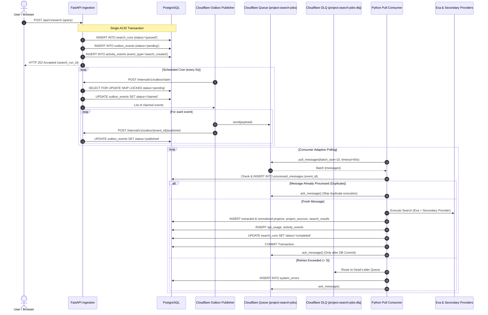

# Queue Architecture & Background Processing
## Project Intelligence Platform

## Overview

The Project Intelligence Platform implements an asynchronous, distributed pipeline utilizing the **PostgreSQL Transactional Outbox Pattern** combined with **Cloudflare Queues** and a **Python Pull Consumer**.

---

## Architecture Flow Diagram



---

## Message Contract (Schema Version 1)

All messages published to `project-search-jobs` follow this strict versioned JSON envelope:

```json
{
  "event_id": "b3f0df68-c1fa-4cb5-bf99-231a473ee16a",
  "event_type": "project_search_requested",
  "schema_version": 1,
  "search_run_id": "87e35b71-12f7-41ab-8547-07469a744432",
  "trace_id": "9d487f54-d8bc-467a-a43b-481cf1317df8",
  "query": "Upcoming hyperscale data center projects in India",
  "parsed_query": {
    "category": "Data Center",
    "location": "India",
    "status": "Upcoming",
    "keywords": ["data center", "hyperscale", "upcoming", "india"],
    "search_intent": "project_discovery"
  },
  "providers": ["exa", "brave"],
  "created_at": "2026-11-13T16:30:00Z"
}
```

---

## Cloudflare Queue Configuration (`wrangler.jsonc`)

### 1. Main Search Queue
- **Name**: `project-search-jobs`
- **Max Batch Size**: 10 messages
- **Max Batch Timeout**: 5 seconds
- **Message Retention**: 4 days (345,600 seconds)
- **Max Retries**: 3 attempts before Dead-Letter Queue routing

### 2. Dead-Letter Queue (DLQ)
- **Name**: `project-search-jobs-dlq`
- **Message Retention**: 14 days
- **Purpose**: Diagnostic quarantine for payloads that repeatedly fail validation, database connectivity, or provider execution.

---

## Idempotency Controls & Safe At-Least-Once Delivery

Because distributed message brokers provide at-least-once delivery, duplicate messages can be delivered upon network partitions or consumer restarts.

To prevent duplicate results or corrupted search status:
1. **`processed_messages` Table**: Contains `(event_id UUID UNIQUE, search_run_id UUID, consumer_id VARCHAR, processed_at TIMESTAMPTZ)`.
2. **Pre-Execution Check**: The consumer attempts to insert into `processed_messages`. If a `UniqueViolation` occurs, the event is immediately flagged as a duplicate, logged at INFO level, and acknowledged at the broker without re-executing search queries or modifying existing project records.
3. **Post-Commit ACK**: A message is **never acknowledged** prior to successful database transaction commit. If a consumer container crashes during provider calls or before database commit, the message visibility timer expires and the message is redelivered to a healthy consumer.
